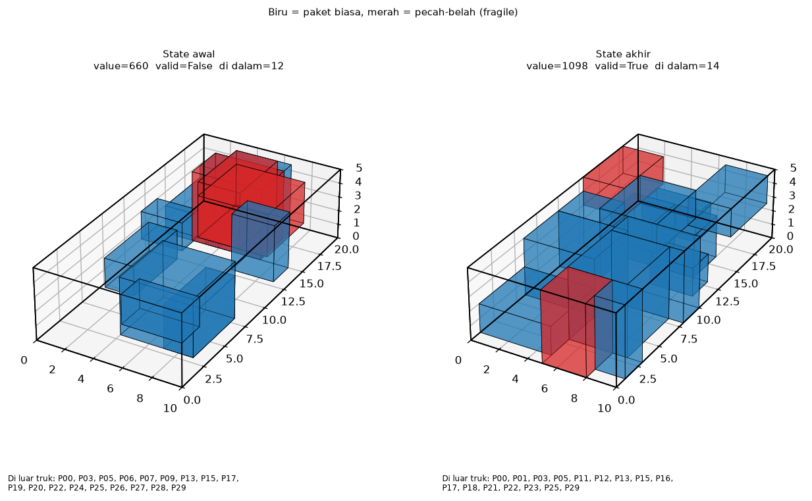
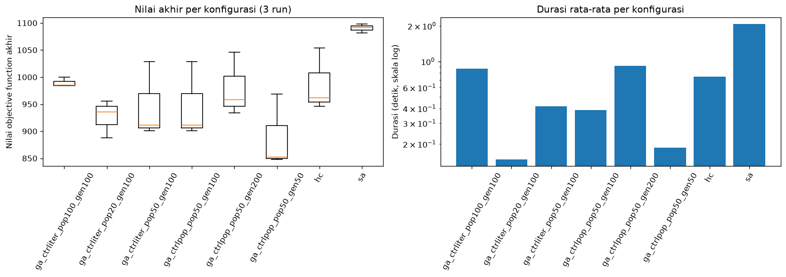
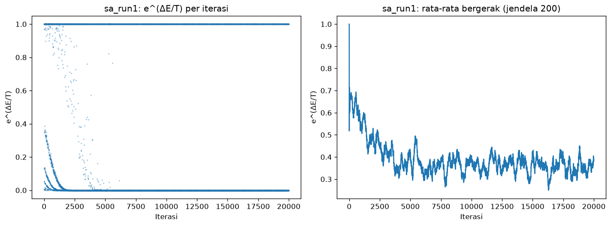

<div align="center">

# Mejiro Express

***Local search* untuk pengisian peti kemas truk: *Hill-climbing*, *simulated annealing*, dan *genetic algorithm*.**

Tugas Besar 1 IF3170 Inteligensi Artifisial · Semester 1 2026/2027 · Kelompok LocalKirkification (39)

[](https://github.com/NaufalArdanni/IF3170_G39_LocalKirkification/actions/workflows/ci.yml)

[](https://docs.astral.sh/uv/)
[](https://docs.astral.sh/ruff/)


[Deskripsi](#deskripsi-singkat-repositori) ·
[Setup](#cara-setup) ·
[Run](#cara-run-program) ·
[Hasil](#hasil-eksperimen) ·
[Arsitektur](#arsitektur) ·
[Pengembangan](#pengembangan) ·
[Kelompok](#pembagian-tugas-tiap-anggota-kelompok)

</div>

---

## Daftar Isi

- [Deskripsi Singkat Repositori](#deskripsi-singkat-repositori)
- [Cara Setup](#cara-setup)
- [Cara Run Program](#cara-run-program)
- [Hasil Eksperimen](#hasil-eksperimen)
- [Arsitektur](#arsitektur)
- [Pengembangan](#pengembangan)
- [Pembagian Tugas Tiap Anggota Kelompok](#pembagian-tugas-tiap-anggota-kelompok)
- [Referensi](#referensi)

## Deskripsi Singkat Repositori

Keluarga Mejiro membuka layanan logistik darat (**Mejiro Express**) dan membutuhkan pengaturan muatan truk yang optimal. Repositori ini menyelesaikan persoalan tersebut dengan tiga algoritma *local search*, yakni memilih paket mana yang dimuat, di mana meletakkannya, dan bagaimana orientasinya agar **total *value* paket di dalam peti kemas maksimal**.

<div align="center">



*State awal (kiri, tidak valid) dan state akhir (kanan, valid, value 1098) pada run `sa_run1`. Biru: paket biasa. Merah: paket pecah-belah.*

</div>

### Persoalan

Tiap paket memiliki dimensi, orientasi (enam kemungkinan), *value*, berat, status pecah-belah, dan ETA. Sebuah *state* memetakan tiap paket ke koordinat bilangan bulat `(x, y, z)` di dalam peti kemas atau ke `None` jika paket berada di luar truk. *State* dinilai dengan rumus berikut:

```text
score(state) = (total value paket di dalam truk) − 1000 × (jumlah pelanggaran)
```

| Batasan | Aturan |
| ------- | ------ |
| Dinding | Paket harus seluruhnya di dalam peti kemas atau seluruhnya di luar |
| Melayang | Paket tidak boleh melayang. Paling sedikit satu titik alasnya harus tertopang lantai atau paket lain |
| Tumpang tindih | Dua paket tidak boleh menempati ruang yang sama |
| Pecah-belah | Paket pecah-belah tidak boleh menjadi penopang paket lain |
| Kapasitas | Total berat paket di dalam truk tidak boleh melebihi kapasitas |

Penalti 1000 lebih besar daripada *value* paket mana pun (maksimum 100) sehingga *state* yang melanggar batasan tidak pernah lebih baik daripada *state* valid yang setara. Penalti memungkinkan pencarian melewati *state* yang belum valid.

### Algoritma

| Algoritma | Berkas | Konfigurasi utama |
| --------- | ------ | ----------------- |
| *Steepest Ascent Hill-Climbing* | [`hill_climbing.py`](src/mejiro_express/hill_climbing.py) | `max_iter=1000`, 100 sampel *move* per iterasi |
| *Simulated Annealing* | [`simulated_annealing.py`](src/mejiro_express/simulated_annealing.py) | `T0=1000`, jadwal geometrik `α=0.999`, 20.000 iterasi |
| *Genetic Algorithm* | [`genetic_algorithm.py`](src/mejiro_express/genetic_algorithm.py) | seleksi turnamen (k=3), *uniform crossover*, mutasi 30%, elitisme |

Langkah tetangga ([`neighbors.py`](src/mejiro_express/neighbors.py)): Menukar dua paket, memindahkan satu paket ke koordinat lain (atau keluar/masuk truk), serta merotasi paket 90° terhadap sumbu x, y, atau z.

## Cara _Setup_

**Prasyarat:** Python **3.14+** dan [uv](https://docs.astral.sh/uv/).

```bash
git clone https://github.com/NaufalArdanni/IF3170_G39_LocalKirkification.git
cd IF3170_G39_LocalKirkification
uv sync
```

`uv sync` membuat lingkungan virtual `.venv` dan menginstal dependensi persis seperti di `uv.lock` sehingga lingkungan sama persis pada mesin apa pun.

<details>
<summary><b>Tanpa uv (pip)</b></summary>

```bash
python -m venv .venv
# Windows (PowerShell): .venv\Scripts\Activate.ps1
# Linux / macOS:        source .venv/bin/activate
pip install -e .
mejiro-express --help
```

</details>

Paket berjalan di Windows, Linux, dan macOS. CI menguji Ubuntu, Windows, dan macOS pada tiap *pull request*.

## Cara _Run_ Program

Jalankan dari direktori utama repositori.

```bash
uv run mejiro-express generate           # Opsional: tulis ulang data/packages.json (30 paket, seed 2026)
uv run mejiro-express run                # Semua eksperimen → output/*.json (sekitar 20 detik)
uv run mejiro-express visualize          # Plot → output/plots/*.png dan tabel ringkasan
uv run python -m mejiro_express.bound    # Batas atas optimum
```

| Perintah | Keterangan |
| -------- | ---------- |
| `generate [--n N] [--seed S] [--output PATH]` | Membangkitkan *instance* acak. Bawaan: 30 paket, seed 2026, truk 10 × 20 × 5, kapasitas 200 |
| `run` | *Hill-Climbing* ×3, *Simulated Annealing* ×3, dan 18 *run* *Genetic Algorithm* |
| `visualize` | Membuat plot *state* awal/akhir 3D, kurva *objective*, e^(ΔE/T) untuk SA, dan `summary.png` |

**Reprodusibilitas**: *Seed* tetap: *Hill-Climbing* *seed* 1–3, *Simulated Annealing* *seed* 101–103, *Genetic Algorithm* *seed* 1–3 (lihat [`demo.py`](src/mejiro_express/demo.py)). *Hill-Climbing* dan *Simulated Annealing* memulai tiap *run* dari *state* awal yang sama.

**Keluaran**: Tiap `output/*.json` memuat *state* awal dan akhir, nilai akhir, durasi, riwayat nilai *objective*, serta data khusus algoritma (jumlah iterasi, `stuck_count`, riwayat e^(ΔE/T), riwayat GA).

> `run` menimpa `output/*.json` dan `generate` menimpa `data/packages.json`. Jika Anda mengubah kode algoritma, jalankan ulang `run`, `visualize`, dan `bound` agar `output/` sesuai dengan kode.

## Hasil Eksperimen

*Instance* 30 paket, *seed* 2026: Total *value* 1732, total berat 427, kapasitas truk 200. Kapasitas berat adalah pembatas utama. Tiap konfigurasi dijalankan 3 kali.

**Batas atas optimum: 1142**, dari relaksasi *fractional knapsack* ([`bound.py`](src/mejiro_express/bound.py)). Batas ini longgar karena mengabaikan geometri, tumpang tindih, dan pecah-belah. Optimum sebenarnya *paling banyak* 1142 sehingga persentase di bawah adalah perbandingan terhadap batas, bukan terhadap optimum.

| Konfigurasi | Min | Rata-rata | Maks | % batas atas (rata-rata) | Durasi rata-rata |
| ----------- | --: | --------: | ---: | -----------------------: | ---------------: |
| **Simulated Annealing** | **1082** | **1090,7** | **1098** | **95,5%** | 2,07 s |
| GA · populasi 100 · 100 generasi | 984 | 989,7 | 1000 | 86,7% | 0,87 s |
| *Hill-Climbing* (*steepest ascent*) | 946 | 987,3 | 1054 | 86,5% | 0,74 s |
| GA · populasi 50 · 200 generasi | 934 | 979,3 | 1046 | 85,8% | 0,92 s |
| GA · populasi 50 · 100 generasi | 901 | 947,0 | 1029 | 82,9% | 0,39 s |
| GA · populasi 20 · 100 generasi | 888 | 926,7 | 956 | 81,1% | 0,15 s |
| GA · populasi 50 · 50 generasi | 848 | 889,7 | 969 | 77,9% | 0,19 s |

<div align="center">



</div>

**Temuan Utama**

- *Simulated Annealing* yang paling baik dan konsisten. *Run* terburuknya (1082) mengalahkan *run* terbaik *hill-climbing* (1054).
- Pada *genetic algorithm*, rata-rata hasil naik seiring bertambahnya generasi (889,7 → 947,0 → 979,3) dan populasi (926,7 → 947,0 → 989,7). Dengan hanya tiga run per konfigurasi, rentang min–maks saling tumpang tindih sehingga tren ini belum pasti.
- Semua 24 *run* menghasilkan *state* akhir yang valid.
- Konfigurasi GA populasi 50 dan 100 generasi muncul di kedua kelompok eksperimen dengan *seed* yang sama sehingga hasilnya identik (secara efektif ada 5 konfigurasi GA yang berbeda).
- *Simulated annealing* rata-rata melewati 8,7 *plateau* tanpa perbaikan (200 iterasi berturut-turut tanpa *state* yang lebih baik dan dihitung sekali per *plateau*).

<details>
<summary><b>Probabilitas Penerimaan e^(ΔE/T) pada <i>Simulated Annealing</i></b></summary>

<div align="center">



</div>

Nilai yang di-*plot* adalah min(1, e^(ΔE/T)). Setelah T turun di bawah 1 (sekitar iterasi 6900), langkah yang memperburuk hampir tidak pernah diterima sehingga SA berperilaku seperti *hill climbing* pada sisa *run*.

</details>

Analisis lengkap terdapat pada laporan yang tersedia di dalam folder [`docs/`](docs/).

## Arsitektur

```text
.
├── src/mejiro_express/
│   ├── model.py                # Package, Truck, State (pos[i] = (x, y, z) atau None)
│   ├── constraints.py          # violations() dan is_valid()
│   ├── objective.py            # score() = value di dalam truk − penalti
│   ├── neighbors.py            # swap, move, rotate
│   ├── hill_climbing.py        # steepest ascent
│   ├── simulated_annealing.py
│   ├── genetic_algorithm.py
│   ├── bound.py                # batas atas optimum (fractional knapsack)
│   ├── data.py                 # pembangkit dan pembaca instance
│   ├── demo.py                 # menjalankan seluruh eksperimen
│   ├── visualize.py            # plot 3D, kurva, ringkasan
│   └── __main__.py             # CLI
├── data/packages.json          # instance masalah
├── output/                     # hasil run, plot/, summary.txt, bound.txt
├── tests/                      # pytest
├── docs/                       # laporan
├── .github/workflows/ci.yml    # CI
└── pyproject.toml, uv.lock     # konfigurasi dan dependensi
```

## Pengembangan

```bash
uv sync                          # Instal dependensi
uv run pre-commit install        # Instal hook commit
uv run ruff check .              # Lint
uv run ruff format --check .     # Format
uv run mypy                      # Tipe
uv run pytest                    # 25 pengujian + laporan coverage
```

| Kakas | Fungsi |
| ---- | ------ |
| [uv](https://docs.astral.sh/uv/) | Manajemen Python, lingkungan virtual, dan dependensi (`uv.lock`) |
| [Ruff](https://docs.astral.sh/ruff/) | *Linting* dan pemformatan |
| [mypy](https://mypy.readthedocs.io/) | Pemeriksaan tipe (mode `strict` dengan pelonggaran sementara untuk modul algoritma) |
| [pytest](https://docs.pytest.org/) | Pengujian: Batasan, *neighbor*, algoritma, CLI, plot, dan batas atas |
| [pre-commit](https://pre-commit.com/) | Pemeriksaan otomatis sebelum *commit*, termasuk format pesan *commit* |
| GitHub Actions | CI: *Lint*, format, tipe, dan pengujian di Ubuntu, Windows, dan macOS |

**Alur kerja**: Pengembangan dilakukan melalui *branch* fitur dan *pull request* ke `dev` dengan pesan *commit* yang mengikuti [Conventional Commits](https://www.conventionalcommits.org/) (`feat:`, `fix:`, `docs:`, `test:`, `refactor:`, `chore:`). *Hook* `pre-commit` menolak *commit* ke `main` dan `dev` secara langsung.

## Pembagian Tugas Tiap Anggota Kelompok

Kelompok LocalKirkification (39)

| NIM      | Nama                         | Tugas |
| -------- | ---------------------------- | ----- |
| 13521154 | [Naufal Baldemar Ardanni](https://github.com/NaufalArdanni)      | Struktur repositori dan konfigurasi (uv, ruff, mypy, pre-commit, CI), integrasi kode menjadi *package*, pengujian, perbaikan algoritma, perbaikan dan penambahan visualisasi, batas atas optimum, README, serta laporan |
| 13524111 | [Reynard Anderson Wijaya](https://github.com/RND815) | Kelas `Package`, `Truck`, `State`, batasan (`constraints.py`), *objective function*, langkah *neighbor*, tiga algoritma (*hill-climbing*, *simulated annealing*, *genetic algorithm*), pembangkit data, skrip eksperimen (`demo.py`), visualisasi awal, serta laporan |
| 13524117 | [Rainaldi Pratama F Sembiring](https://github.com/R27-04) | Pengujian dan pelengkapan laporan |

## Referensi

1. M. L. Khodra, "Beyond Classical Search: Classical vs Local Search," YouTube, 2020. <https://www.youtube.com/watch?v=oGTa9kGE3P8>
2. M. L. Khodra, "Beyond Classical Search: State (Value, Neighbor)," YouTube, 2020. <https://www.youtube.com/watch?v=_6rla37QorM>
3. M. L. Khodra, "Beyond Classical Search: Hill-climbing Search," YouTube, 2020. <https://www.youtube.com/watch?v=L0b0CN3Fds8>
4. M. L. Khodra, "Beyond Classical Search: Simulated Annealing," YouTube, 2020. <https://www.youtube.com/watch?v=AdhG7HnhYrk>
5. M. L. Khodra, "Beyond Classical Search: Genetic Algorithm," YouTube, 2020. <https://www.youtube.com/watch?v=aI41TGo9J9c>
